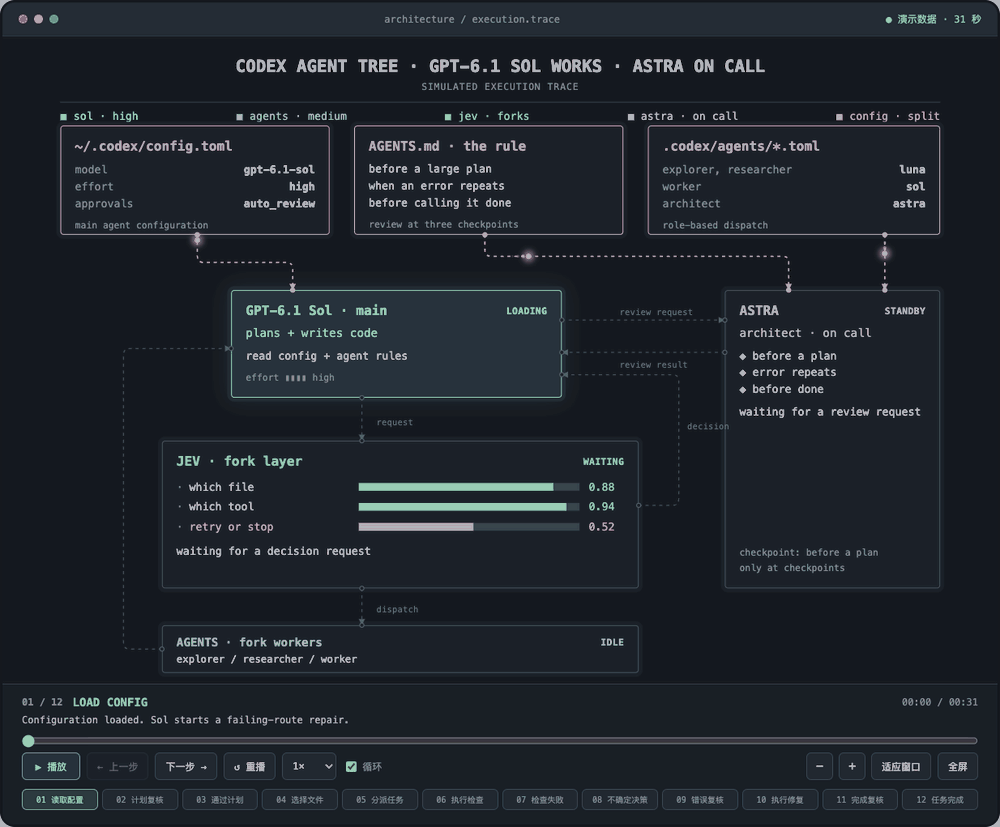

# animate-architecture

**把系统调用与数据流，变成可以播放的架构图。**

Replayable architecture diagrams, built with Python and played in a single offline HTML file.

用深色终端窗口、SVG 连线和沿路径移动的光点，展示组件之间的调用、数据流与执行状态。可以安装为 Codex skill，也可以直接用 Python 构建。



[查看案例](#examples) · [安装 skill](#install) · [直接构建](#build) · [数据格式](skills/animate-architecture/references/diagram-format.md)

- **可以回放**：播放、暂停、单步、拖动进度、倍速、缩放和全屏。
- **可以离线分享**：生成单文件 HTML，播放时不需要服务器或网络。
- **可以换成自己的系统**：用 JSON 描述节点、连接、状态与时间线；Python 标准库即可构建。

## Examples

下面的案例使用模拟数据，不调用真实模型、支付接口或业务服务。点击 HTML 链接后下载文件，再用浏览器打开；GitHub 文件页展示的是源码。

| 案例 | 展示内容 | 文件 |
|---|---|---|
| Agent 协作 | 7 个节点、9 条连线、12 个阶段，约 31 秒 | [HTML](examples/agent-tree/index.html) · [GIF](examples/agent-tree/demo.gif) · [截图](examples/agent-tree/preview.png) |
| 订单处理 | 客户端、订单、支付、事件队列与仓库，约 14 秒 | [HTML](examples/order-flow/index.html) · [截图](examples/order-flow/preview.png) |
| 中心协调与反馈 | 中心节点与多条反馈路径，约 12 秒 | [HTML](examples/hub-feedback/index.html) · [GIF](examples/hub-feedback/demo.gif) · [截图](examples/hub-feedback/preview.png) |

也可以只下载一个案例，无需安装 Python：

```bash
curl -fL https://raw.githubusercontent.com/Albus-Hedwig/animated-architecture-skill/main/examples/agent-tree/index.html -o agent-tree.html
```

双击 `agent-tree.html` 即可播放。

## Install

需要 Git、Python 3。先克隆仓库，再安装 skill：

```bash
git clone https://github.com/Albus-Hedwig/animated-architecture-skill.git
cd animated-architecture-skill
python3 scripts/install.py
```

默认安装到 `${CODEX_HOME:-~/.codex}/skills/animate-architecture`；如果已有副本，安装器会先保存到 `skill-backups/`。`skills/animate-architecture/` 是完整可移植的 skill 和后续更新来源。

新建 Codex 会话，然后输入：

> 使用 $animate-architecture，把我的订单处理系统画成终端风格动态图。组件包括客户端、订单服务、支付、事件队列和仓库。演示从提交订单到支付确认、发布事件和仓库履约的过程，给我可离线播放的 HTML。

已有真实架构时，提供组件、职责、调用关系与典型场景即可。

## Build

在仓库根目录运行，不依赖 Codex 或模型 API：

```bash
python3 skills/animate-architecture/scripts/build.py skills/animate-architecture/assets/agent-tree.json --output dist/agent-tree.html
python3 skills/animate-architecture/scripts/build.py skills/animate-architecture/assets/order-flow.json --output dist/order-flow.html
python3 skills/animate-architecture/scripts/build.py skills/animate-architecture/assets/hub-feedback.json --output dist/hub-feedback.html
```

打开生成的 HTML 即可播放。制作自己的图时，参考 [数据格式](skills/animate-architecture/references/diagram-format.md) 和 [设计规则](skills/animate-architecture/references/design-and-validation.md)，修改 JSON 中的节点、路径和时间线。

布局需要在 JSON 中明确指定。改变拓扑时，需要重新安排框边端口与绕线路径；当前没有自动布局或拖拽编辑器。

## Validation & GIF export

构建与安装使用 Python 标准库。真实浏览器验证和 GIF 导出需要额外工具，按需安装即可。

```bash
python3 -m unittest discover -s tests
python3 -m unittest discover -s skills/animate-architecture/scripts -p 'test_*.py'
python3 skills/animate-architecture/scripts/verify_browser.py --doctor
python3 skills/animate-architecture/scripts/verify_browser.py dist/agent-tree.html --output-dir dist/preview --preview-step 8
```

验证器默认复用已安装的 `agent-browser`；没有该 CLI 时使用当前 Python 环境中的 Playwright。它检查所有阶段，默认只保存代表图与小屏图；`--all-steps` 可保存每阶段截图。浏览器会阻断外部请求，不使用个人浏览器资料；验收失败不会换后端重试。

GIF 需要 Playwright 和 Pillow。按 [独立环境安装说明](skills/animate-architecture/references/browser-setup.md) 安装固定版本，再用该环境的 Python 执行验证器并加 `--gif`。工具会查找现有 Chrome，不会自动下载浏览器。

2026-10-08 已在 Linux 用现有 Chrome 验证两个浏览器后端和 GIF；报告见 `examples/`。Mac 路径有单元测试，实际 Mac 安装与浏览器验收尚未执行。维护者可用 `ANIMATE_BROWSER_TESTS=1` 运行五项真实浏览器反例检查；加 `ANIMATE_BROWSER_ENGINE=playwright` 则检查 Playwright 路径。

## Maintenance

更新仓库后，重新安装以同步本地 skill；本地安装副本是快照。

```bash
git pull --ff-only
python3 scripts/install.py
```

开发规则见 [AGENTS.md](AGENTS.md)，版本记录见 [CHANGELOG.md](CHANGELOG.md)。修改 `skills/animate-architecture/` 后，验证受影响的案例，再更新示例和本地安装。

## License

本项目采用 [MIT License](LICENSE)，版权署名为 `Copyright (c) 2026 Albus-Hedwig`。除另有明确声明外，许可覆盖本仓库的代码、skill 文档、HTML 模板、示例配置和由这些示例渲染的预览。

单独安装或分发 skill 时，保留其目录中的 [LICENSE](skills/animate-architecture/LICENSE)。模板和生成的单文件 HTML 内含完整 MIT 声明，复制或修改后继续保留。

使用者自行提供的业务内容和第三方素材不因使用本工具而自动适用 MIT；生成 HTML 中包含的本项目渲染器仍需保留许可声明。参考来源及依赖范围见 [ATTRIBUTIONS.md](ATTRIBUTIONS.md)。
